# Virtual Obelisk

A social platform for artists of every kind, from painters and photographers to musicians, poets and video artists,
built with **Flutter** and **Firebase**. Artists share their work, grow an audience, climb a rank ladder, and
create art together in community "chains".

> 🎓 Built as my **Bachelor's thesis project**.
>
> 📦 **Archived.** The live deployment is offline. You can still run the full app locally with the
> Firebase Emulators (see [Running locally](#running-locally)).

## Screenshots

### Every kind of art, with its own reader

| Images | Audio, with cover art |
|:---:|:---:|
| 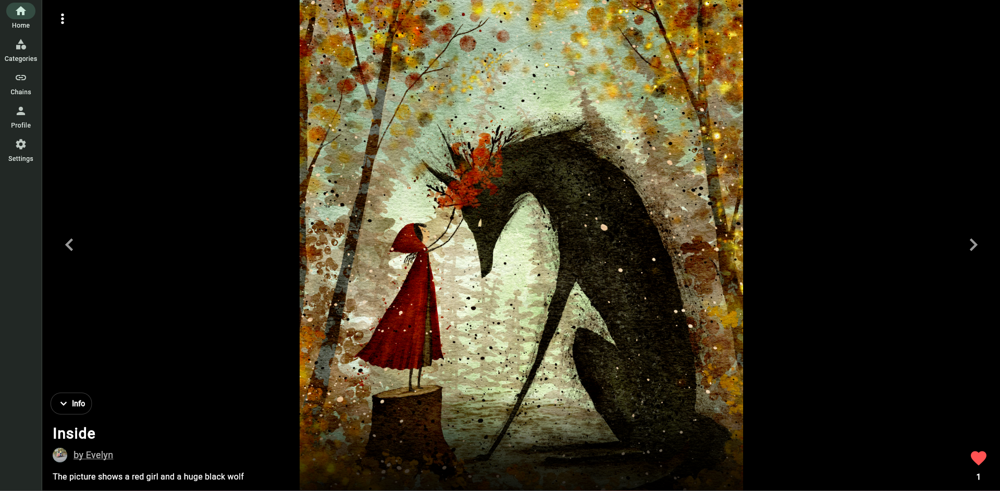 | 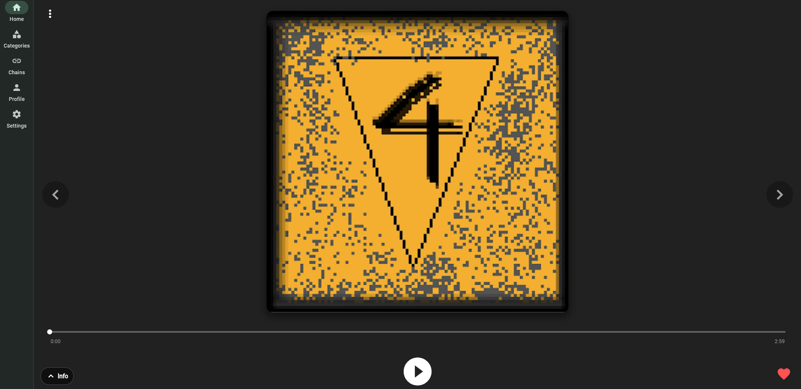 |
| **Video** | **Text, split into pages like a book** |
| 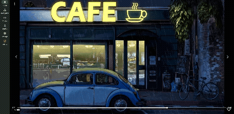 | 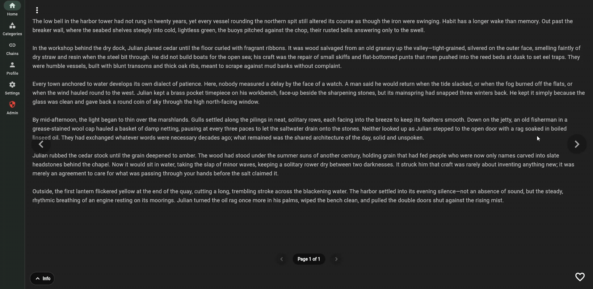 |

### Profiles, following and ranks

Following an artist gives them a follower and +100 Artist Points (800 → 900 AP). The Security Rules only allow
this together with a real follow record.

| Before following | After following |
|:---:|:---:|
| 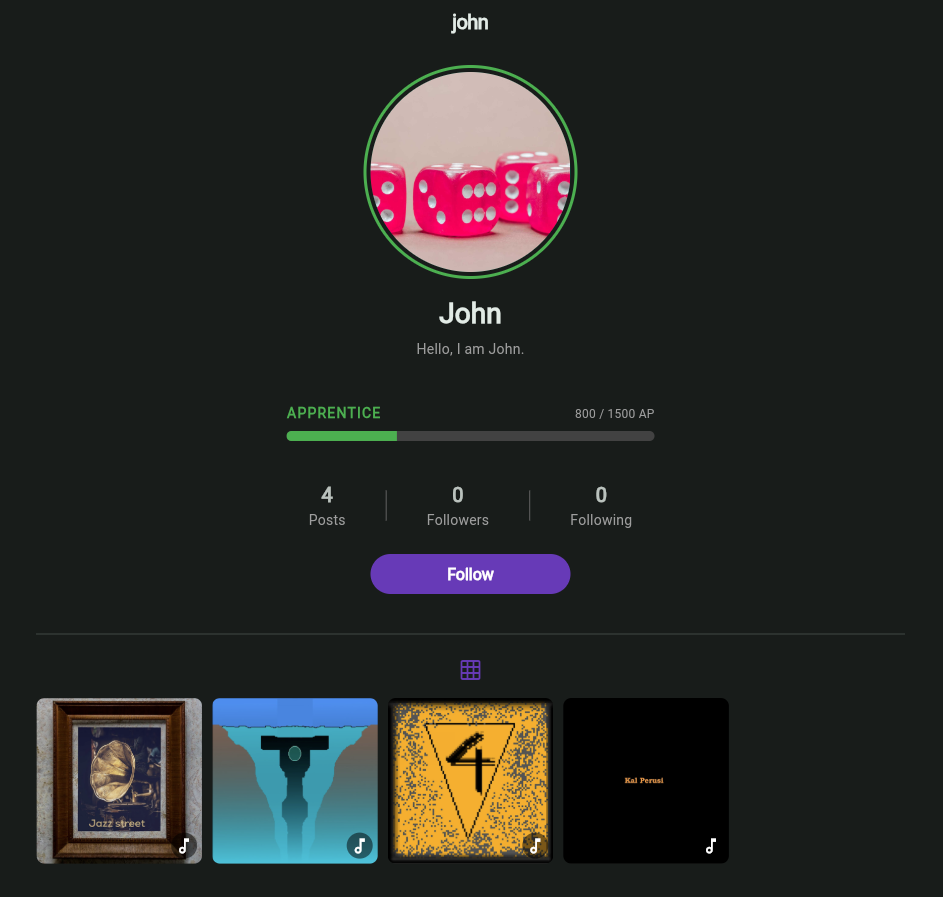 | 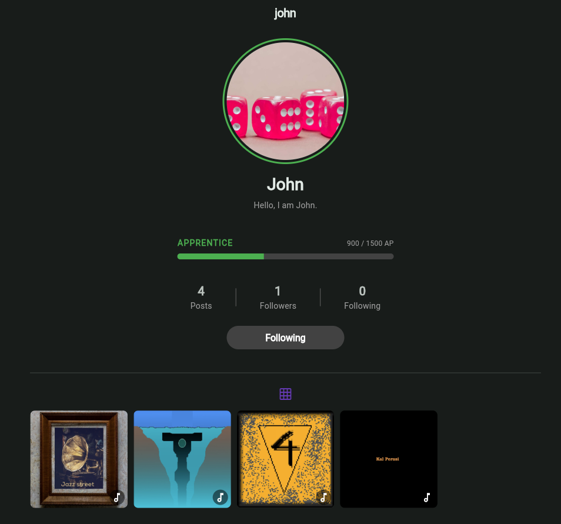 |

| Your profile | Uploading, with progress |
|:---:|:---:|
| 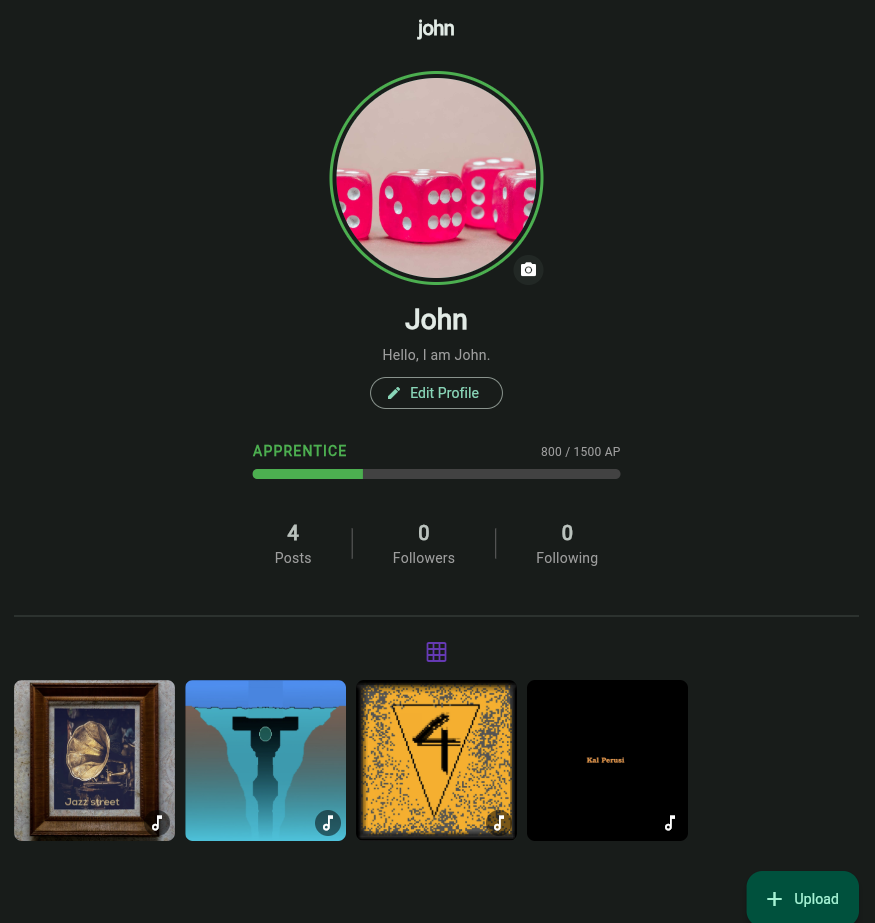 | 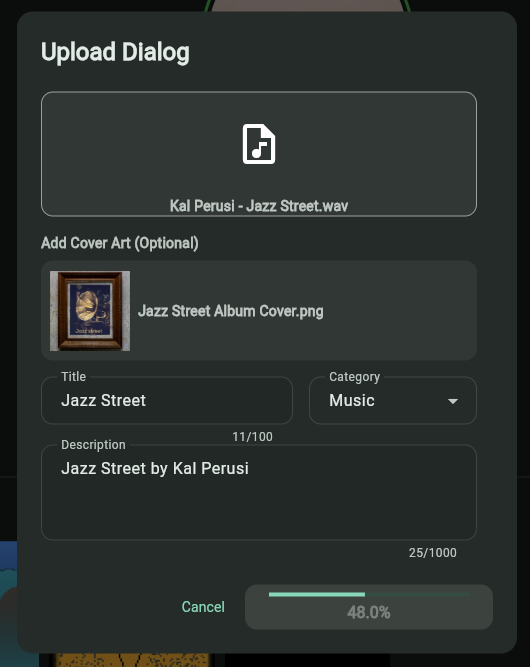 |

### Art chains

| Active chains | A chain's timeline |
|:---:|:---:|
| 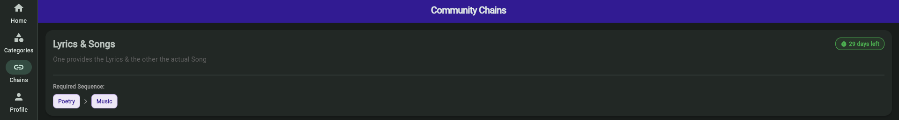 | 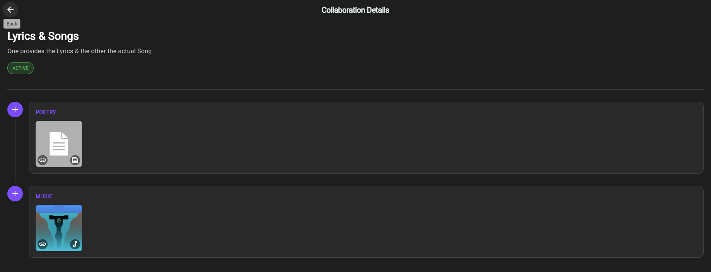 |

<p align="center"><b>Creating a chain (admin)</b><br>
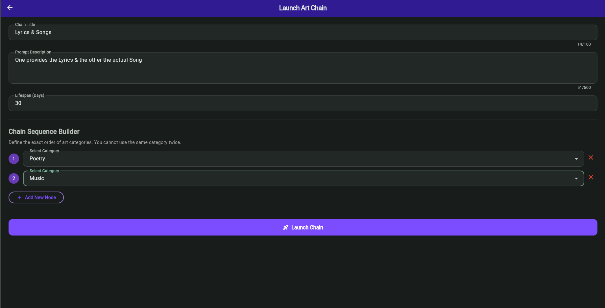</p>

### Categories, reporting and moderation

| Browsing categories | Reporting a post |
|:---:|:---:|
| 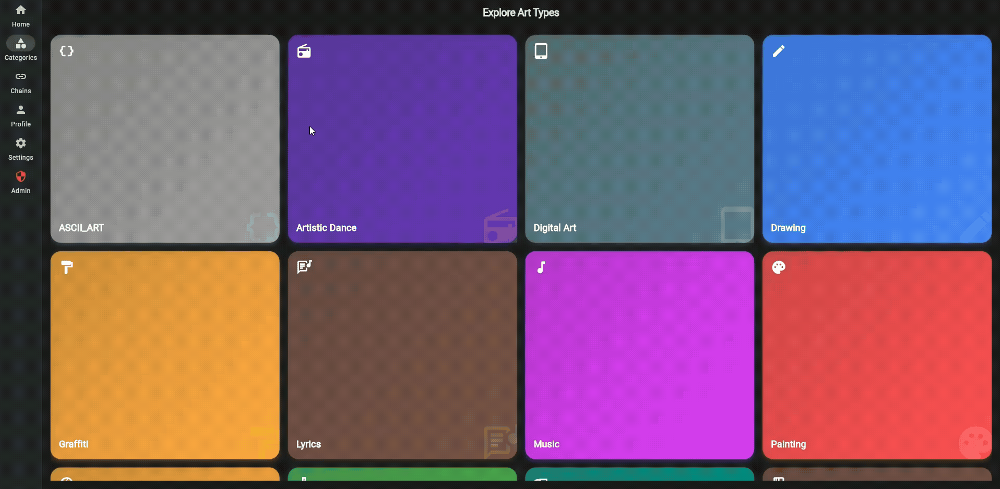 | 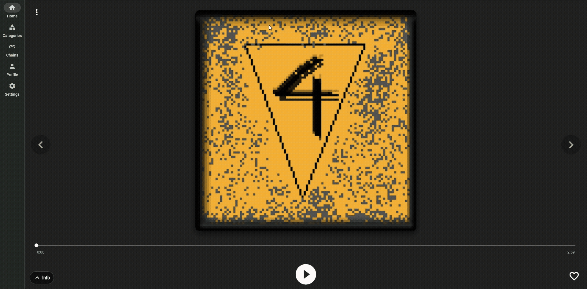 |
| **Admin dashboard** | **Moderation queue** |
| 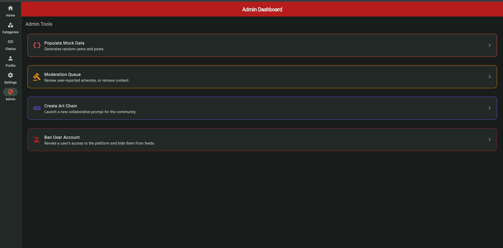 | 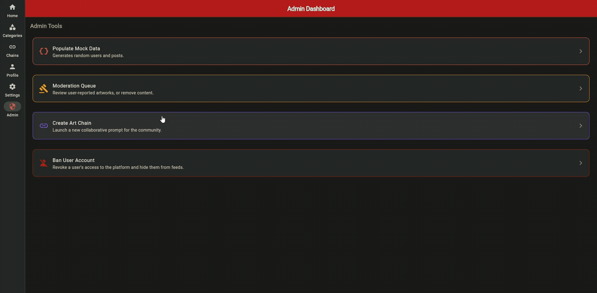 |

## Features

### Share any kind of art
- **Four media types:** images, video, audio and text, detected automatically from the uploaded file (MIME type).
- **13 categories**, including Digital Art, Photography, Music, Poetry, Pixel Art, Graffiti and Artistic Dance.
- **Cover art and thumbnails:** audio posts can have cover art, and video posts a thumbnail.
- **A dedicated reader for each media type:**
  - an audio player
  - a video player
  - a text reader that splits long writing into pages, like a book
- **Platform-aware uploads:** web uploads raw bytes, while mobile streams the file from disk so large videos don't
  run out of memory. Uploads show a progress bar.

### A feed that rewards involvement
The home and category feeds aren't chronological. They're generated by a custom **weighted lottery**
(`lib/core/feed_engine.dart`), so active artists get seen more, while everyone still has a chance:
1. **Pick an artist:** each artist's chance is proportional to their *Artist Points*.
2. **Pick one of their posts:** each post's chance is proportional to its likes.
3. **Never repeat:** posts already shown are skipped, and artists with nothing left to show are excluded.
4. **Infinite scrolling:** the pool of artists is loaded 100 at a time from Firestore, and topped up as the feed
   runs out.

### Artist Points and ranks
- Artists earn **Artist Points (AP)** for uploading (+200), gaining a follower (+100) and receiving a like (+50).
- AP moves artists up seven ranks, from **Novice** to **Legend**, shown as a progress bar on their profile.
- A scheduled **Cloud Function** removes 100 AP from every artist each day, so ranks reflect *current* activity,
  not just past work.
- To keep things fair, uploads are limited to **2 per 24 hours**.

### Art chains
Community prompts where artists build on each other's work across disciplines:
- An admin defines an **ordered sequence of categories**, e.g. *Poetry → Music → Video Art*, and a lifespan in days.
- Artists contribute to each step, and the chain is shown as a **timeline**.
- Chains close automatically when they expire. Chain uploads don't count toward the daily limit.

### Social
- Profiles with an avatar, a bio, and a gallery of all posts.
- Unique usernames, set up right after sign-up.
- Follow other artists, and browse anyone's followers and following lists.
- Likes.
- Email verification before entering the app.

### Moderation and admin tools
- Any user can **report** a post. After **5 reports**, it's automatically hidden from all feeds.
- An **admin dashboard**, visible only to accounts with the `admin` role:
  - a moderation queue for reported posts, to restore or remove them
  - banning accounts: banned users are locked out of the app, hidden from feeds, and blocked by the Security Rules
  - creating art chains
  - a mock data generator for testing

### Responsive design
- One codebase for web and mobile.
- A bottom navigation bar on phones, and a side navigation rail on larger screens.
- Light and dark themes that follow the system setting.

## Tech stack

| | |
|---|---|
| **App** | Flutter, Dart, `go_router` (navigation), `just_audio`, `video_player`, `file_picker` |
| **Backend** | Firebase Authentication, Cloud Firestore, Cloud Storage, Cloud Functions (Node.js), Firebase Hosting |
| **Security** | Firestore and Storage Security Rules (in this repo) |
| **Testing** | `flutter_test` (unit and widget tests), Firebase Emulator Suite |

## Security

All data access is enforced on the server by Firebase Security Rules (`firestore.rules`, `storage.rules`), not by
the app. Some highlights:
- **No self-promotion to admin:** users can't change their own role.
- **Banned accounts can't write anything**, even with direct API access.
- **Counters must match real records:** likes, followers, Artist Points and post counts can only change by the
  exact amounts the app uses. Each change must be made atomically, together with the record that justifies it
  (the like, the follow, the new post). A rule checks that this record appears or disappears in the same write.
- **One report per user per post**, and posts are deactivated exactly at 5 reports.
- **The daily upload limit is enforced on the server**, not just in the app.
- **Storage:** only the uploader (or an admin) can delete a file, files are limited by type and size per folder,
  and the bucket can't be listed.

## Project structure

```
lib/
├── core/           # Feed engine, constants, MIME type detection
├── data/
│   ├── models/     # ArtPost, ArtChain, UserModel, ...
│   └── repositories/  # All communication with Firebase (Auth, Firestore, Storage)
├── config/         # Routes (go_router) and theme
├── ui/
│   ├── screens/    # Home, Categories, Chains, Profile, Admin, Auth, ...
│   └── widgets/    # Media reader, players, dialogs, profile widgets, ...
├── automation/     # Mock data generator
└── main.dart
functions/          # Cloud Function: daily Artist Points decay
firestore.rules     # Firestore Security Rules
storage.rules       # Storage Security Rules
```

## Running locally

The app runs fully on your machine with the **Firebase Emulator Suite**. No Firebase account or billing is needed.

**Requirements:** Flutter SDK, Node.js with the Firebase CLI (`npm install -g firebase-tools`), and Java.

```
flutter pub get
firebase emulators:start --import ./emulator-data --export-on-exit
flutter run -d chrome --dart-define=USE_EMULATORS=true
```

- `USE_EMULATORS=true` connects the app to the local emulators instead of the real Firebase project
  (see `_connectToFirebaseEmulators()` in `lib/main.dart`).
- The emulator database starts empty. Sign up in the app: the email verification link is printed in the
  emulator terminal.
- To use the admin tools, set a user's `role` to `admin` in the Emulator UI at http://localhost:4000.
- `--import`/`--export-on-exit` keep your test data between sessions, in `emulator-data/` (not committed).

### Tests

```
flutter test
```

The tests cover the core logic that doesn't need Firebase:
- the feed's weighted lottery (`pickWeighted` in `lib/core/feed_engine.dart`), including that picks are
  proportional to weight and that artists with 0 points still get a chance
- media type detection for uploads
- the rank progress bar

## Firebase notes

### Security Rules

The Firestore and Storage Security Rules live in this repository:

- `firestore.rules` (and `firestore.indexes.json`)
- `storage.rules`

Edit them here, then deploy with:

```
firebase deploy --only firestore:rules,storage:main
```

### Storage bucket

The app does **not** use the project's default Storage bucket. The original default bucket was deleted
when the data was moved to a new region, and all files now live in the bucket **`art-platform-878d0`**.

Because of this:

- `firebase.json` uses the Storage deploy target `main`, and `.firebaserc` maps `main` to the bucket
  `art-platform-878d0`, so rules deploy to the right bucket. (Set up with
  `firebase target:apply storage main art-platform-878d0`.)
  `firebase init storage` will not work for this project, and is not needed.
- `lib/firebase_options.dart` uses `storageBucket: 'art-platform-878d0'`.
  **If you ever re-run `flutterfire configure`, it will overwrite this with the old default bucket name, and
  uploads/downloads will break.** Change `storageBucket` back to `'art-platform-878d0'` for every platform afterwards.
- Do not click "Get started" in the Storage section of the Firebase Console. It would create a new, empty default bucket.
- In the Emulator UI, open the bucket directly at http://localhost:4000/storage/art-platform-878d0
  (the plain "Storage" tab opens the old default bucket and shows an error).

## Credits

- Some of the images and videos shown in the screenshots are from [Pixabay](https://pixabay.com/), used under the
  [Pixabay Content License](https://pixabay.com/service/license-summary/). All accounts shown are fictional test accounts.
- Default user avatar icon: [UXWing](https://uxwing.com/user-profile-icon/)
